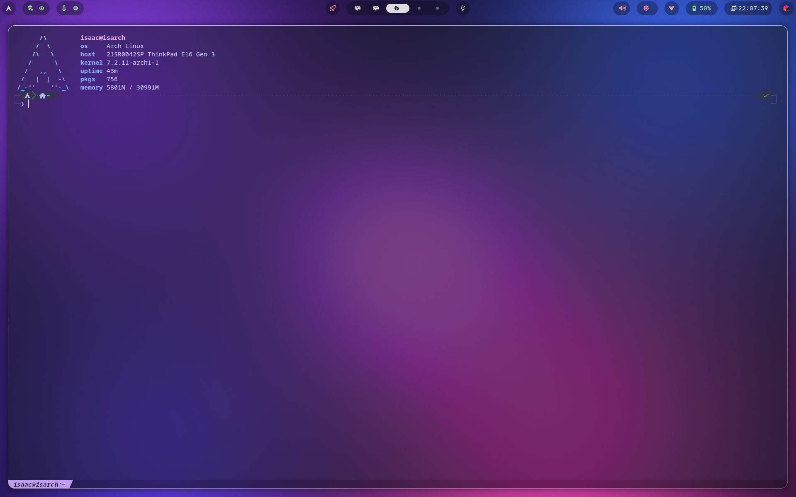
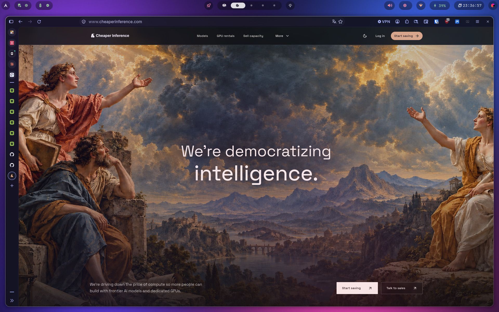
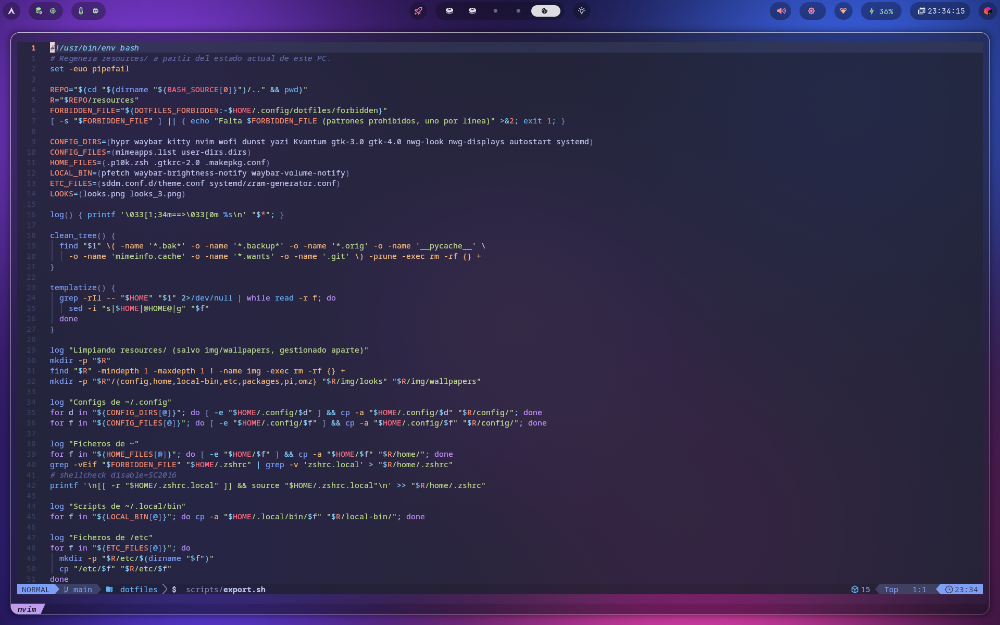
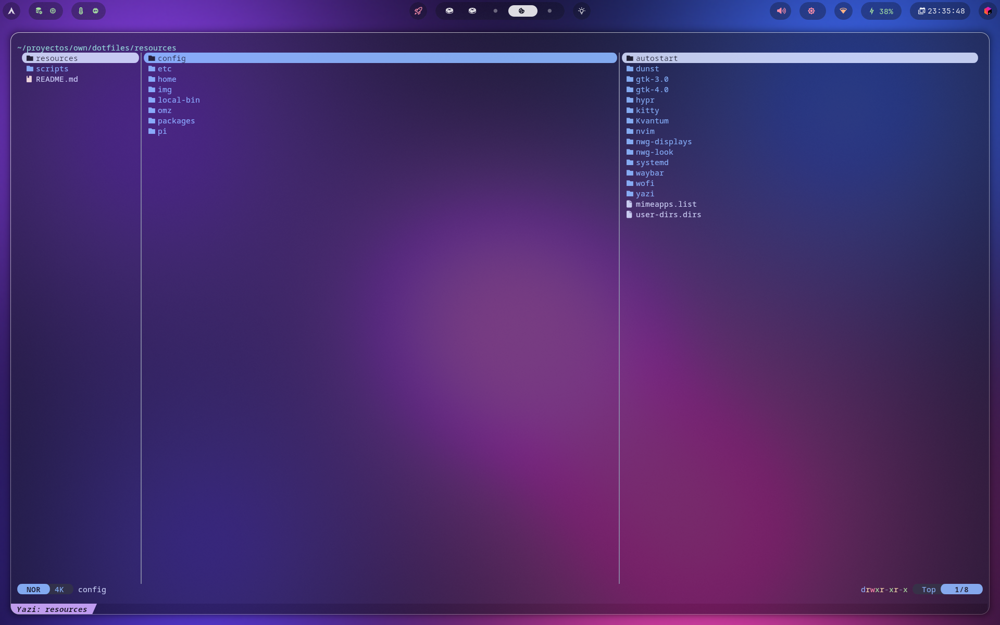
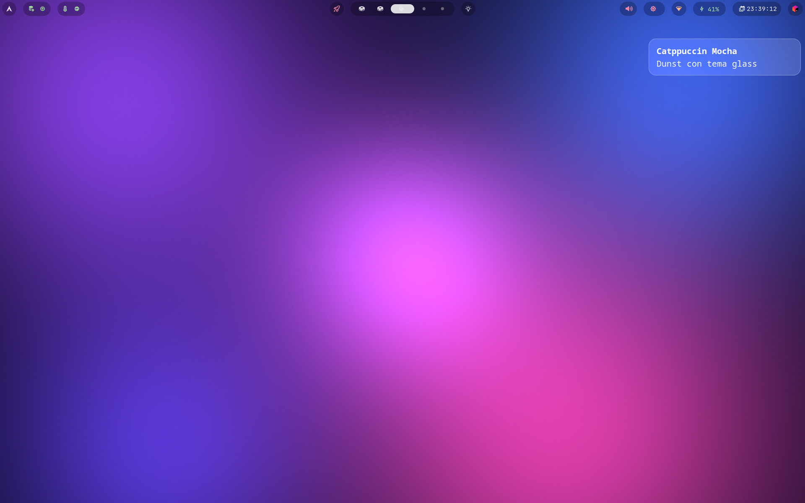

# dotfiles

Mi escritorio en Arch Linux + Hyprland, tema Catppuccin Mocha "glass".







## Qué incluye

| Área | Componentes |
|---|---|
| Escritorio | Hyprland (config en Lua), hyprpaper, hyprlock, waybar, wofi, dunst, nwg-displays, nwg-look |
| Terminal | kitty, zsh + oh-my-zsh + powerlevel10k (Catppuccin), pfetch, neovim (LazyVim), yazi |
| Tema | GTK Catppuccin Mocha Lavender, iconos Colloid, cursores Catppuccin, Kvantum, SDDM `where_is_my_sddm_theme` |
| Agente | Extensiones y temas de [pi](https://pi.dev) y la lista de paquetes de pi |

## Estructura

```text
resources/
├── config/      -> ~/.config
├── home/        -> ~ (.zshrc, .p10k.zsh, .gtkrc-2.0)
├── local-bin/   -> ~/.local/bin
├── etc/         -> /etc (SDDM, zram)
├── omz/         plugins de oh-my-zsh sin repo git
├── pi/          -> ~/.pi/agent (extensions, themes)
├── packages/    pacman.txt, aur.txt, npm-global.txt, pi-packages.txt,
│                omz-repos.txt, services-*.txt, jetbrains.txt
└── img/
    ├── wallpapers/  -> ~/Pictures/Wallpapers (Git LFS)
    └── looks/       capturas
scripts/
├── install.sh   monta todo en un Arch nuevo
└── export.sh    regenera resources/ desde el PC actual
```

## Instalar en un Arch nuevo

```bash
sudo pacman -S --needed git git-lfs
git lfs install
git clone https://github.com/Sticky0/dotfiles.git ~/proyectos/own/dotfiles
cd ~/proyectos/own/dotfiles
scripts/install.sh --dry-run   # ver qué haría
scripts/install.sh
```

Opciones: `--no-packages`, `--no-aur`, `--no-services`.

Las configs se **copian**, no se enlazan. Lo que ya existiera se guarda en
`~/.dotfiles-backup-<fecha>/`. Las rutas absolutas se guardan como `@HOME@` y se
sustituyen al instalar.

Después, a mano: claves SSH/GPG, sesión en las apps, IDEs desde JetBrains
Toolbox, credenciales de pi y reiniciar.

## Actualizar el repo

```bash
scripts/export.sh && git status
```

`export.sh` falla si encuentra algún patrón de `~/.config/dotfiles/forbidden`
(lista local que no se sube). Lo que no se quiera publicar del `.zshrc` va en
`~/.zshrc.local`.

## Qué NO se sube

Credenciales (`.ssh`, `.gnupg`, `.git-credentials`, `.npmrc`, auth de pi y
OmniRoute), historiales, sesiones de apps, ajustes de IDE, la configuración
personal del agente (AGENTS.md, memoria, settings) ni la identidad de git.
